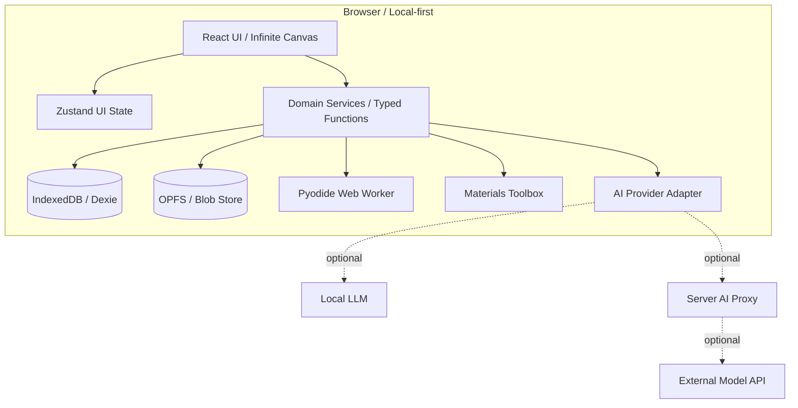

# Hypothesis Graph — Scientific Canvas 設計書

> **材料科学者のための「無限ホワイトボード × 科学計算 × 仮説検証AI」**  
> ドキュメント種別: プロダクト・技術設計書 / Cursor実装用  
> 版: v0.1.0（初期設計）  
> 作成日: 2026-10-26  
> 想定運用: 研究者個人のローカルファースト利用から開始し、研究室内共有へ段階的に拡張
>
> **改訂の参照（2026-10-26）:** 本書と食い違う箇所は [implementation-plan.md](./implementation-plan.md) の「0. 前提の改訂」を優先する。対応する設計判断は [ADR-008](./decisions/008-local-server.md)、[ADR-009](./decisions/009-command-event-sync.md)、[ADR-010](./decisions/010-project-room-identity.md)。これらは設計判断であり、実装の完了ではない。

---

## 0. エグゼクティブサマリー

Hypothesis Graph は、材料科学の研究活動を**一枚の広大なホワイトボード上で行う**ためのWebアプリケーションである。問い・仮説・メカニズム・予測・実験計画・観測結果・論文を知識グラフとして構造化し、それらの間に周期表、Shannonイオン半径、組成計算、CIF結晶構造、Python/Wasm、グラフなどの**実行可能な科学ツール**を直接配置する。

一般的なAIチャットと異なり、議論を使い捨ての会話ログに閉じ込めない。AIが提案した仮説、研究者が採用した解釈、実測値、計算値、文献の主張を分離し、各主張が**何を根拠とし、何によって反証され得るか**を追跡できるようにする。

アプリの価値は主に次の3点にある。

1. **Think:** 研究仮説を可視化・分岐・比較し、対立する説明を整理する。
2. **Compute:** 材料科学ツールとブラウザ上のPythonを使い、その場で計算・図示する。
3. **Test:** 観測結果を知識グラフに取り込み、次に実施すべき識別力の高い実験を設計する。

**実装方針:** まずはサーバー不要・ローカル保存・単独ユーザー・ブラウザ完結のMVPを作る。AI API、共同編集、外部DB連携、大規模シミュレーションは疎結合な拡張機能として後から追加する。

### 0.1 一文で表すプロダクト

> **研究者が「思考・調査・計算・データ解釈・次の実験の設計」を同じ無限キャンバスで行い、再現可能な研究成果として保存するツール。**

### 0.2 MVP完了の定義

ユーザーが新しい研究ボードを作り、仮説を3つ追加し、周期表とイオン半径カードを置き、CSVを取り込み、Pythonセルで計算してグラフ化し、仮説へ結果を紐付け、アプリを再起動しても再現できること。AIが無効でもこのワークフローが成立すること。

---

## 1. 背景・課題・ターゲット

### 1.1 現状の課題

- ChatGPT等の対話は有用だが、長期研究では以前の仮説・反証・意思決定の経緯が流れる。
- マインドマップは思考整理に向くが、科学データ、計算コード、測定条件やデータ来歴を保持しにくい。
- Jupyterは計算に優れるが、複数の競合仮説や研究プロジェクト間の関係を俯瞰しにくい。
- 測定ファイル、論文PDF、実験ノート、CIF、計算コードが分散する。
- AIが生成する「もっともらしい説明」と測定から支持された結論が混同されやすい。
- 実験計画が「何を測れるか」中心になり、「どの仮説を区別できるか」が明示されない。

### 1.2 想定ユーザー

- 全固体電池、固体電解質、電極界面を研究する研究者。
- 合成・結晶構造・電気化学・表面分析・理論計算を横断する材料科学者。
- 研究テーマを進める学生、学生の研究をレビューする指導者。
- 将来的には材料科学以外の物理・化学・生物・工学研究者。

### 1.3 代表的な研究テーマ

- **Li–Mg合金負極:** 性能向上の要因（接触、界面化学、速度論、Li拡散）を区別する。
- **LGPS系固体電解質:** 元素置換、Liサイト占有、局所構造、ホッピング障壁、導電率の関係を検討する。
- **圧力依存EIS:** 圧力・試料厚み・バルク/粒界/界面抵抗の関係を解釈する。

### 1.4 設計原則

| 原則 | 必須仕様 |
|---|---|
| Scientific integrity | 観測・解釈・仮説・推定・AI提案を明確に区別する |
| Falsifiability | 仮説には反証可能な予測または検証条件を記述できる |
| Provenance first | 数値と主張は可能な限り元ファイル・文献・計算履歴へ遡れる |
| Canvas as a view | ホワイトボード上のカードと、保存される研究アーティファクトを分離する |
| Local first | AI接続・サーバーがなくても中核機能が使える |
| Composable tools | 計算カードは型付き入出力を介して連結できる |
| Human in the loop | AIは研究者の承認なく科学的結論や元データを上書きしない |
| Extensible | 材料計算ツール・ファイルパーサーをプラグインとして追加可能にする |

### 1.5 初期版でやらないこと

- DFT/MDをブラウザ内で本格実行すること。
- 全Pythonパッケージの動作保証。
- LLMによる研究仮説の自動的な「証明」や「確定」。
- 自動論文執筆と投稿。
- 多人数リアルタイム編集、複雑な権限管理。
- EIS/XRD/XPSのすべての高度なフィッティング機能を最初から自作すること。
- Materials Project等への外部API接続をMVPの前提とすること。

---

## 2. UX・画面設計

### 2.1 メイン画面（デスクトップ優先）

```text
┌──────────────────────────────────────────────────────────────────────────────┐
│ HG  Projects / LGPS Research        Search (⌘K)        History   Save   ⚙  │
├───────┬───────────────────────────────────────────────────────────┬──────────┤
│ Tools │                 INFINITE SCIENTIFIC CANVAS                │ Inspector│
│       │                                                           │ / AI     │
│  ↖    │   ┌──────────────────────┐                                │          │
│  ✋    │   │ Research Question    │                                │ Node     │
│  ✎    │   │ 導電率が変わる理由は？│                                │ details  │
│  ▤    │   └───────┬──────────────┘                                │          │
│  ⬡    │           ├──────────────────┐                            │ Evidence │
│  ⚗    │           ▼                  ▼                            │ Source   │
│  </>   │    ┌──────────┐       ┌──────────┐                        │          │
│  ◫    │    │ Hypo: H1 │       │ Hypo: H2 │                        │ AI Chat  │
│  ◉    │    └──────────┘       └──────────┘                        │          │
│       │                                                           │          │
│       │  ┌─────────────┐    ┌──────────────────────┐             │          │
│       │  │ Periodic    │───▶│ Python / Wasm        │             │          │
│       │  │ Table       │    │ code / output        │             │          │
│       │  └─────────────┘    └──────────┬───────────┘             │          │
│       │                                ▼                           │          │
│       │                          ┌────────────┐                   │          │
│       │                          │ Plot Card  │                   │          │
│       │                          └────────────┘                   │          │
├───────┴───────────────────────────────────────────────────────────┴──────────┤
│ Minimap       zoom 75%     Undo/Redo         Python Ready     Local Saved   │
└──────────────────────────────────────────────────────────────────────────────┘
```

**4領域:**

1. **上部バー:** プロジェクト切替、ボード名、検索、履歴、エクスポート、設定。
2. **左ツールバー:** 選択、パン、ペン、付箋、仮説、実験、コード、元素、結晶、データ、グラフ。
3. **中央キャンバス:** ズーム、パン、カードの移動・リサイズ・接続・フレーム化。
4. **右インスペクター:** 選択カードの詳細、根拠、実行履歴、AI提案チャットをタブで表示。

右ペインは非表示にできる。カードのインライン編集を基本とし、詳細設定のみインスペクターを使う。

### 2.2 キャンバス操作

| 操作 | 仕様 |
|---|---|
| Pan | Space+ドラッグ / ミドルドラッグ / トラックパッド |
| Zoom | ホイール・ピンチ・ツールバー。カーソル位置中心 |
| Select | クリック、Shift+クリック、範囲選択 |
| Move / Resize | タイトルバーをドラッグ、コーナーハンドルで変更 |
| Connect | カード間の関係線を作成。関係の意味を選択する |
| Freehand | ペン・消しゴム・図形・テキスト・矢印（段階的に実装） |
| Group/Frame | 関連カードを枠で囲み、移動・折りたたみ可能 |
| Duplicate | ⌘/Ctrl+D。元データ参照の共有か複製か選択可能 |
| Search | ⌘/Ctrl+K。ノード名、種類、組成式、文献、試料IDで検索 |
| Undo/Redo | ⌘/Ctrl+Z / Shift+⌘/Ctrl+Z |
| Save | 編集後デバウンスしてローカル保存、明示的スナップショット |
| History | スナップショットの比較・復元・ブランチ作成（高度機能は後期） |

### 2.3 Semantic Zoom（意味的ズーム）

- **遠景（例: 0.15–0.45倍）:** カードの見出し・種類・状態のみ表示。高コストなチャート描画は省略。
- **中景（例: 0.45–0.9倍）:** カード要約・縮小プレビュー・主要接続を表示。
- **近景（例: 0.9倍以上）:** コード編集、計算結果、原子構造の操作等を有効化。

閾値は暫定設定。描画負荷と実際のUXを計測して調整する。拡大率による表示切替は**データの削除や計算の停止を意味しない**。

### 2.4 3種類の「線」を分ける

1. **Semantic Relation（知識の関係）**: `supports`、`contradicts`、`predicts`、`tests`、`explains` など。双方向でない場合は矢印の向きを保持する。ループ可。
2. **Dataflow Connection（データの流れ）**: `table -> python -> chart` などの型付きポート間接続。**DAG（閉路禁止）**。
3. **Visual Connector（装飾線）**: 説明用の矢印・手描き線。科学的な関係を示すものとしては扱わない。

線の見た目だけで意味を推測しない。タイプ、始点終点、説明、作成者、作成時刻を保存する。

### 2.5 ボード内モード

- **Canvas View:** 自由なブレインストーミング・計算・付箋・手描き。
- **Reasoning View:** 研究課題から仮説・予測・根拠への関係を強調。
- **Experiment View:** 実験候補・対照条件・結果を一覧化。
- **Publication View:** 主張、図表、裏付け、未検証項目を表示（後期）。

同じ研究データを異なる表示で見る設計とし、ビューの切り替えで複製データを作らない。

---

## 3. ノード・カード仕様

すべてのカードは共通の `CanvasItem` 表現（位置・寸法・折りたたみ状態・参照先）を持ち、実体データは `Artifact` として保存する。

| カード種別 | 表示・主機能 | 初期段階 |
|---|---|---|
| `question` | 研究課題・目的・制約 | M1 |
| `hypothesis` | 仮説本文・反証条件・状態 | M1 |
| `mechanism` | 物理/化学機構の説明 | M1 |
| `prediction` | 条件付きの定性/定量予測 | M1 |
| `experiment` | 実験計画・対照・判定基準 | M1/M3 |
| `observation` | 実際の観測事実・測定条件 | M1 |
| `evidence` | 観測・文献から導いた支持/反証関係 | M3 |
| `source` | 論文・DOI・ファイル・装置ログ | M1/M3 |
| `note` | リッチテキスト・Markdown付箋 | M1 |
| `periodic-table` | 周期表、元素比較 | M2 |
| `ionic-radius` | 半径比較、選択条件 | M2 |
| `composition` | 組成、モル質量、電荷中性、仕込量 | M2 |
| `python` | Pyodideコードと実行履歴 | M2 |
| `table` | CSV/TSV・計算結果の表 | M2 |
| `chart` | 2Dグラフ、散布図、フィッティング | M2 |
| `crystal` | CIF/POSCAR、3D原子配置、サイト選択 | M3 |
| `frame` | グループ、実験系列、論文構成 | M1 |
| `image` | 画像貼り付け、注釈 | M1 |
| `chemical-equation` | 反応式、電荷・原子数の確認 | M3 |

**備考:** `M1/M2/M3` は下記マイルストーンに対応。最初の開発で全カードを実装しない。

### 3.1 仮説カード

**必須フィールド:** タイトル、仮説文、対象条件、検証可能な予測（少なくとも1件を推奨）、反証可能性、状態、作成者、更新日時。

状態例: `proposed`（提案）、`under-test`（検証中）、`consistent`（現状の証拠と整合）、`challenged`（反証あり）、`inconclusive`（未決着）、`superseded`（改訂前）。`proven` のような機械的な確定状態は設けない。

**重要:** 仮説は排他的とは限らない。界面接触とSEI組成の両方が性能に寄与する場合もあるため、`competes_with` と `can_coexist_with` を区別できること。

### 3.2 予測カード

- 適用条件、介入因子、固定すべき因子、期待する観測量。
- 可能なら数値範囲・不確かさ・予測モデルを添付。
- **「この結果ならH1を支持しH2を弱める」という識別ルールは事前登録**できる。
- 実験後に予測文を変更した場合は新リビジョンにし、元の予測を残す。

### 3.3 観測カードと根拠カード

- **Observation:** `pressure = 10 MPa`、`R_interface = ... Ω cm²` など、測定・抽出された事実を保持。
- **Evidence:** 観測が特定仮説に対してどの程度支持的／反証的かという**解釈**を保持。
- Observationには元ファイルのハッシュ、解析コード、測定条件を紐付ける。
- 異なる測定条件のデータを単純比較しない。不明な条件は `unknown` として残す。

---

## 4. 材料科学Toolbox

### 4.1 Periodic Table

**MVP機能**

- 全元素の周期表。名称、原子番号、族・周期、原子量、代表的酸化数、電気陰性度等を表示。
- 元素の複数選択・比較。プロパティの熱マップ表示はM3。
- 選択元素を`ElementSelection`としてデータポートから渡せる。
- 元素カードを仮説や組成計算カードへドラッグできる。
- 各物性に`source / datasetVersion / unit / nullable`を付与する。

**禁止:** 欠損プロパティをゼロとして扱わない。資料ごとに定義の異なる「原子半径」などを混在させない。

### 4.2 Ionic Radius Explorer

**MVP機能**

- Shannon (1976) の**effective ionic radius**を基本に、元素・酸化数・配位数・スピン状態で検索。
- `ionic` と `crystal` 半径を明確に区別して表示。
- 同じ基準で選択した複数イオンを表・棒グラフで比較。
- 半径不一致率 `|r_dopant-r_host|/r_host × 100%` を計算。
- 参照元、原単位と明示的な表示換算（Å）、データセット版、データが存在しない場合の注意を表示（[ADR-012](./decisions/012-scientific-data-sources.md)）。

**科学的制約**

- CNや酸化数が不明なら単一の半径を断定しない。
- スピン状態依存のデータがある場合、選択条件を必須にする。
- 値が存在しない条件では `null / unavailable` を返す。**近似値を断りなく補間しない**。
- 半径比較は同じ定義、同じ単位または記録した明示的換算を用いる。同じ出典・版かを確認し、異なる／不明な出典・版を含むときは、そのことを明示して利用者が選択した比較にする（[ADR-012](./decisions/012-scientific-data-sources.md)）。
- 半径差から置換可否や導電率を直接断定しない。共有結合性、局所配位、結晶格子、電荷補償等を別途考慮する。
- Shannon半径の一般的な適用範囲と、硫化物・ハロゲン化物等への適用上の注意を表示する。

**データ管理:** 初期版では第三者物性表を同梱せず、利用者の手元のファイルを読み込む（[ADR-012](./decisions/012-scientific-data-sources.md)。実装は未了）。出典・利用条件の不明点を保持し、第三者表は、Room = Project の同期と完全な ZIP 往復を前提に利用範囲を確認してから取り込む。範囲外の共有・出力は欠落で隠さず拒否し、公開サンプルへの第三者表の収録には同 ADR の同梱ゲートを要する。生の紙面表を無断で自動スクレイピングして埋め込まない。

### 4.3 Composition Calculator

- 組成式パーサー: `Li10GeP2S12`、`Li4.3P0.7Si0.3S4I`、`Li10+xGe1+xP2-xS12` など（変数式は段階的に実装）。
- 原子数、原子比、モル質量、元素ごとの質量分率。
- 仕込量計算: ターゲット質量と前駆体を指定して物質量・必要質量を算出。
- 形式酸化数の指定に基づく電荷中性チェック。
- 置換量変更時、価数不一致と必要な電荷補償を**候補として提示**。
- 表・Python・仮説カードに結果を出力。

**解析の境界:** 形式酸化数は仮定であり、実際の電子構造や結合状態の保証にはならない。

### 4.4 Crystal Viewer（M3）

- CIFインポート、格子・原子サイト・分率座標・占有率の表示。
- 対称操作を正しく展開できるパーサーを採用し、空間群番号・操作・原子数・化学式を検証。
- 周期境界条件、スーパーセル、結合距離、配位環境、サイトハイライト。
- 選択サイトを Ionic Radius Explorer / Site Substitution Explorer に渡す。
- 部分占有サイト、混合サイト、磁性/無秩序系は制約を表示。
- POSCARのインポートはM3以降。**結晶構造の対称操作を独自の簡略処理で推測しない。**

### 4.5 Electrochemistry Toolkit（M3）

最初に実装する候補:

- Arrheniusフィット: `ln σ` vs `1/T`、活性化エネルギー、不確かさ。
- EISのCSVインポート、Nyquist/Bode表示、測定条件の確認。
- 単位換算（電流密度、面積抵抗、導電率、厚さ、圧力）。
- GITTの簡易可視化、拡散モデルに対する条件比較。
- 理論容量と膜厚/面積からの容量換算。

**非MVP:** 高度な等価回路フィット、DRT、Rietveld解析等は専用ツールまたは後期プラグインとして扱う。

### 4.6 Common Utilities

| ツール | 入力 | 出力 |
|---|---|---|
| Unit Converter | `value, fromUnit, toUnit` | 値、換算式、単位 |
| Constant Reference | 物理定数名 | 値、定義、出典 |
| CSV Inspector | CSV/TSV | 列名、単位、数値型、欠損率、プレビュー |
| Plot Builder | テーブルと軸設定 | SVG/PNG、グラフカード |
| DOI Card | DOI/文献メタデータ | 書誌情報、引用、主張メモ |
| Experiment Matrix | 因子・水準・固定条件 | 比較表、試料案、実験計画 |

---

## 5. Python/Wasm 設計

### 5.1 採用方式

- **Pyodide + Web Worker（module Worker）**を採用し、UIスレッドから計算を分離。
- 初期ロードは**遅延実行**。Pythonカードの初回実行時のみ環境を起動する。
- Pyodideの安定版を**固定バージョン**で配布し、CDNの `latest` / `dev` を参照しない。
- 主要パッケージは利用可能なPyodideビルドを確認して同梱・キャッシュする。
- MVPで優先するパッケージ: `numpy`, `scipy`, `pandas`, `matplotlib`。その他は互換性確認後に追加。
- Pyodide非対応のネイティブ依存パッケージを、一般のPython環境と同じようにインストールできると約束しない。

### 5.2 Pythonカードの仕様

| 機能 | 仕様 |
|---|---|
| エディタ | MonacoまたはCodeMirror。Syntax Highlight、入力補完は段階追加 |
| 実行 | Run / Run All / Stop（ワーカー終了・再生成を含む） |
| 出力 | stdout、stderr、例外、テーブル、PNG/SVG、JSON |
| 入力 | 接続した上流カードの構造化データ |
| 再実行 | 手動が初期デフォルト。自動実行は明示設定かつDAGのみ |
| パッケージ | 許可リスト、版固定、インストール可否・サイズを明示 |
| 履歴 | ソースコード版、入力ハッシュ、実行時刻、Python/Pyodide版、結果ハッシュ |
| 保存 | セルコードと表示結果を永続化。Pythonプロセス状態には依存しない |

### 5.3 変数スコープ

**原則: セル間の暗黙的なグローバル変数共有を要求しない。**

- 1カードが独立した入力・出力を宣言できるようにする。
- ボード単位で1つのWorkerを共有してもよいが、セルのデータ依存は**Dataflow Connectionだけ**から構築する。
- ランタイム再起動時は保存済みの入力・コードから再現可能であること。
- ノートブック特有の「実行順依存による隠れた状態」を最小化する。

### 5.4 入出力プロトコル

```ts
type PortDataType =
  | "number"
  | "text"
  | "json"
  | "table"
  | "series"
  | "element-selection"
  | "ionic-radius-selection"
  | "composition"
  | "structure-ref"
  | "binary-ref";

type PortValue = {
  type: PortDataType;
  schemaVersion: 1;
  value?: unknown;       // JSON互換の小さな値だけ
  blobId?: string;       // 大きなデータはBlob参照
  unit?: string;
  provenanceId?: string;
};

type PythonRunRequest = {
  runId: string;
  artifactId: string;
  code: string;
  inputs: Record<string, PortValue>;
  packageManifest: Record<string, string>;
  timeoutMs: number;
};

type PythonRunResult = {
  runId: string;
  status: "success" | "error" | "terminated";
  stdout: string;
  stderr: string;
  outputs: Record<string, PortValue>;
  durationMs: number;
  environmentHash: string;
};
```

**実装指針:** Worker内では入力JSONを検証し、明示的なヘルパー（例: `inputs`, `emit_table`, `emit_series`, `emit_json`）をPythonに公開する。UIとWorker間で非シリアライズ可能なオブジェクトを直接保持しない。Matplotlib図は安全なラスタ画像などに変換して保存する。

### 5.5 セル接続例

```text
Periodic Table ──(element-selection)──┐
                                     ▼
Ionic Radius ──(ionic-radius-selection)──▶ Python ──(table)──▶ Plot
                                           │
                                           └──(json)──▶ Hypothesis / Evidence
```

- 予期しない型のポート接続は拒否または明示変換を要求する。
- 値の変更で下流セルを `dirty` にする。勝手に再実行して根拠を置き換えない。
- セル実行時に入力リビジョン・出力リビジョンを記録する。
- データフローに閉路ができたら接続を拒否する。

### 5.6 計算中断・エラー処理

- 正常終了、Python例外、パッケージ不足、タイムアウト、手動停止、メモリ不足を区別して表示。
- 「Stop」は可能なら公式割り込み機構、確実な停止が必要なら**Workerのterminate → 再生成**で対応する。
- 他の処理への影響を避けるため、初期版では同時実行数を1（キュー方式）に制限してよい。
- 重い処理を実行してもパン・ズーム等のUI操作はブロックしない。
- 長時間・高メモリ処理は警告。ブラウザ内計算には環境依存の制限がある。

### 5.7 セキュリティ上の前提

**Pyodide + Workerは完全な悪意あるコード用サンドボックスではない。** PythonからJavaScriptブリッジ等にアクセスし得るため、MVPでは**研究者が自分で記述した信頼できるコードのみを実行**する仕様とする。

- AIが提案したコードを自動実行しない。差分表示と明示承認が必要。
- 第三者からインポートしたPythonコードを自動実行しない。
- 機密データやシークレットをWorkerグローバルへ無制限に公開しない。
- 不特定ユーザーが投稿したコードを安全に実行させる場合は、別オリジンの制限環境やサーバー側隔離等を再設計する。
- 許可なく`fetch`などによる外部送信を行う実装・AIアクションを含めない。

---

## 6. AI Research Partner

### 6.1 AIの役割

| Mode | 動作 | 出力 |
|---|---|---|
| Brainstorm | 対象課題の説明候補を列挙 | 仮説ノード候補 |
| Critical Reviewer | 交絡、反証、代替機構を指摘 | 批判・不足情報・代替仮説 |
| Experimental Designer | 競合仮説を識別する実験を提案 | 実験カード候補・予測表 |
| Data Interpreter | 観測から解釈可能なこと・不可能なことを整理 | Evidence候補・追加実験 |
| Literature Synthesizer | 読み込んだ文献を比較（後期） | 出典付き主張・矛盾候補 |
| Paper Story Builder | 裏付けのある主張を構成（後期） | 図構成・論理の抜け |

### 6.2 会話コンテキスト

- 選択したカード、近傍カード、対象プロジェクトの要約、指定した出典のみを優先的に送る。
- 巨大なボード全体や原データを無条件で毎回送信しない。
- `project-local`、`selected-only` などの送信範囲をUIで明示する。
- AIとの会話は独立したChat履歴として保存し、採用した提案だけを正式なArtifactに変換する。

### 6.3 AI編集フロー（必須）

```text
ユーザー指示
   │
   ▼
AIが構造化変更案（ProposedChangeSet）を生成
   │
   ▼
スキーマ検証・参照整合性チェック
   │
   ▼
画面上に追加/更新予定のノード・線をプレビュー
   │
   ▼
研究者が個別またはまとめて承認
   │
   ▼
トランザクション保存 + Undo対応 + AI由来の記録
```

- LLMの出力を直接Canvasの内部状態に注入しない。
- AIは承認なしに元ファイル、観測、実験ログ、既存の研究者の文章を上書きできない。
- 出典未確認の主張は `unverified`。モデルが生成した引用やDOIを検証済みと表示しない。
- 観測と主張に整合性がない場合は「矛盾」と「適用条件の違い」を区別する。
- 定量的な仮説確率やBayesian EIGは、予測分布・尤度が明示されたときのみ使用する。

### 6.4 実験計画AIの最小仕様

各候補実験には次を含める。

1. 研究課題と識別対象の仮説集合。
2. 操作因子、固定条件、対照試料、繰返し回数の候補。
3. 測定する観測量と、各仮説における予測（定性的でもよい）。
4. 主な交絡因子、測定手法の限界、望まれる精度。
5. 所要時間・コスト・使用設備（不明なら「要入力」）。
6. 結果A/B/Cが出たときに次に進む検証。

**優先順位付け:** MVPでは「識別力・実現可能性・コスト・交絡リスク」を人が入力・修正できる**定性的な比較**とする。LLMの印象を確率として表示しない。

### 6.5 AI接続アーキテクチャ

- `AiProvider` というアダプター境界を設ける。
- ローカルモデル（Ollama等）とAPIモデルは実装を分離。
- **MVPではAIなしで全基本機能が動く。**
- 商用APIの秘密鍵を配布済みフロントエンドにハードコードしない。共有・本番運用ではサーバー側プロキシが必要。
- ローカルの試験的BYOKを実装する場合、保存せずセッション限定とし、利用者に送信先とリスクを表示。
- LLMに渡したデータ範囲と利用プロバイダーを表示・ログ化する。

---

## 7. データ設計

### 7.1 最重要設計判断：モデルと表示を分離

**研究上の実体（Artifact）**と**画面上の表現（CanvasItem）**は別テーブルとする。

```text
Project
 ├── Board 1 ── CanvasItem A ──┐
 │              CanvasItem B ──┼──▶ Artifact (実体)
 ├── Board 2 ── CanvasItem C ──┘        │
 │                                      ├── Revision
 └── Artifact ──────────────────────────└── Source / Provenance

SemanticRelation : Artifact ──relation──▶ Artifact
DataflowEdge     : CanvasItem.port ────▶ CanvasItem.port
VisualConnector  : CanvasItem ──display──▶ CanvasItem
```

同じ計算結果・仮説を複数ボードに配置しても、元データの複製は必須ではない。カードを削除しても参照先のArtifactを自動削除しない。

### 7.2 エンティティ

| Entity | 役割 | 主な属性 |
|---|---|---|
| `Project` | テーマの単位 | id, title, description, createdAt |
| `Board` | ホワイトボード | id, projectId, name, viewport, version |
| `Artifact` | 仮説/データ/計算/文献の実体 | id, projectId, kind, payload, revisionId |
| `ArtifactRevision` | 内容の変更履歴 | id, artifactId, parentId, payload, author, createdAt |
| `CanvasItem` | 画面上のカード | id, boardId, artifactId?, x, y, width, height, viewState |
| `SemanticRelation` | 仮説・根拠間の意味関係 | id, fromArtifactId, toArtifactId, relation, rationale |
| `DataflowEdge` | 入出力ポート接続 | id, fromItemId, fromPort, toItemId, toPort |
| `VisualConnector` | 説明用・手描き矢印 | id, boardId, source, target, style |
| `DataBlob` | バイナリ・大型ファイル | id, sha256, mime, size, filename, storageRef |
| `ExecutionRecord` | Python実行来歴 | id, artifactId, codeHash, inputs, outputs, versions, status |
| `Provenance` | 数値・主張の出自 | id, originType, sourceIds, createdBy, method, timestamp |
| `ExperimentCondition` | 測定・介入条件 | id, experimentId, property, quantity, provenanceId |
| `Snapshot` | 復元点 | id, projectId, boardId, createdAt, manifestRef |

IDはUUID/ULID等の衝突回避形式。ファイル保存形式には `schemaVersion` を必須とする。

### 7.3 科学データの値モデル

```ts
type ScientificQuantity = {
  value: number;
  unit: string;              // e.g. "mS/cm", "MPa", "angstrom"
  uncertainty?: number;      // 単位はvalueと同じ
  uncertaintyType?: "sd" | "se" | "ci95" | "instrument";
  significantFigures?: number;
  method?: string;
  provenanceId?: string;
};

type EvidencePolarity = "supports" | "contradicts" | "mixed" | "neutral";

type SemanticRelationType =
  | "supports"
  | "contradicts"
  | "predicts"
  | "tests"
  | "explains"
  | "depends_on"
  | "competes_with"
  | "can_coexist_with"
  | "derived_from"
  | "references";

type HypothesisPayload = {
  title: string;
  statement: string;
  applicability: string[];
  refutationCriteria: string[];
  status:
    | "proposed"
    | "under-test"
    | "consistent"
    | "challenged"
    | "inconclusive"
    | "superseded";
  tags: string[];
};
```

**必須検証:** `NaN`/`Infinity`、ゼロ割り、単位不整合、温度の°C/K混同、百分率と分率の混同に対してエラーか明確な変換を行う。データの有効桁数と単位を勝手に書き換えない。

### 7.4 保存形式

- **メタデータ・アーティファクト:** IndexedDB（Dexie等で管理）。
- **大型バイナリ:** 原則OPFS、対応不可ならIndexedDB Blobへフォールバック。
- **データ識別:** `sha256`により同一ファイルの重複登録を判定。
- **autosave:** 変更から数百ms〜1秒程度でデバウンス保存。未保存状態をUI表示。
- **snapshot:** 重要な変更前、明示保存時、インポート前に作成。
- **migration:** スキーマ版ごとにupgrade関数を定義し、過去データを保護。
- **バックアップ:** プロジェクト単位のZIPエクスポート（`manifest.json`, JSON, blobs, metadata）。

保存容量が不足する場合は事前警告し、不要な計算キャッシュを削除するUIを用意する。ブラウザストレージは永久保存を保証しないため、手動バックアップを目立つ導線に配置する。

### 7.5 プロジェクトZIP例

```text
LGPS-research.hypograph.zip
├── manifest.json                 # formatVersion / projectId / exportedAt
├── project.json
├── boards/
│   ├── main.json                 # CanvasItems / connectors / viewport
│   └── experiments.json
├── artifacts/
│   ├── artifacts.json
│   ├── revisions.json
│   ├── relations.json
│   └── executions.json
├── datasets/
│   └── shannon-metadata.json    # 使用データ版の参照（著作物の無断複製はしない）
└── blobs/
    ├── <sha256>.csv
    ├── <sha256>.cif
    └── <sha256>.png
```

### 7.6 ログ・履歴方針

- `undo/redo`: Canvas操作のCommand履歴。ページ再読込での完全維持は後期。
- `revision`: 仮説文、予測、コード、解析条件の変更前後を保存。
- `snapshot`: ボード全体の復元点。読み込み時に不整合検査。
- 科学的な結論に関する重要変更は「誰が・なぜ・何を」を記録する。

---

## 8. アーキテクチャ

### 8.1 構成図



### 8.2 推奨技術スタック

| 分野 | 採用候補 | 決定理由・留意点 |
|---|---|---|
| Web | Vite + React + TypeScript (strict) | SPA、静的ホスティング、開発速度 |
| Build | Vite Plus環境に合わせても可 | 実装時の実パッケージ版を固定 |
| Canvas | **React Flow `@xyflow/react`** | ノード・エッジ・ズーム機能が成熟、MITライセンス |
| Drawing | Canvas/SVGオーバーレイ（段階追加） | 自由描画はReact Flow単体の主要用途ではない |
| UI | Tailwind CSS + shadcn/ui | カスタマイズしやすい |
| State | Zustand | 一時的なUI状態 |
| Validation | Valibot | 境界でのRuntime型検証 |
| Result型 | neverthrow（任意） | 失敗を明示する関数型サービス |
| Persistence | IndexedDB + Dexie | ローカルファースト永続化 |
| Blob storage | OPFS + fallback | ファイル・計算出力の保存 |
| Python | Pyodide + Web Worker | ブラウザ内CPythonと数値計算 |
| Code Editor | CodeMirrorまたはMonaco | シンタックスハイライトと編集 |
| Plots | Plotly.jsまたはECharts | インタラクティブな科学グラフ |
| 3D | Three.js系または結晶ビューア | CIF表示は専用parserと分離 |
| Test | Vitest + Testing Library + Playwright | Unit / UI / E2E |
| AI | Provider adapter (M3) | LLM選択、送信管理、差分承認 |
| Future Backend | Hono + SQLite / MongoDB等 | 共有機能は将来の拡張 |

**Canvas選択メモ:** tldrawは汎用無限ホワイトボードに非常に適する一方、本番利用ではライセンス確認が必要。初期実装はReact Flowを採用し、キャンバスAdapter層を設けて将来差し替えられるようにする。独自描画レイヤーは選択/ズーム/パン座標に正しく同期すること。

### 8.3 モジュール境界

- **Domain:** `hypothesis`, `evidence`, `experiment`, `scientific-quantity`, `artifact`。
- **Canvas:** ノード・レイアウト・描画・接続・ズーム・ショートカット。科学的意味の判断を持たせない。
- **Materials:** 元素表、イオン半径、組成計算、構造解析などの純粋関数。
- **Compute:** Pyodide、入出力、実行記録、スケジューラー。
- **Persistence:** RepositoryインターフェースとIndexedDB/OPFS実装。
- **AI:** プロンプト、ツール仕様、提案差分、検証、承認。
- **Import/Export:** CSV/CIF/JSON/ZIPと版移行。

UIコンポーネントからデータベースの生クエリやPyodideインスタンスを直接操作しない。

### 8.4 プロジェクトディレクトリ案

```text
hypothesis-graph/
├── AGENTS.md
├── README.md
├── package.json
├── src/
│   ├── app/
│   │   ├── App.tsx
│   │   └── providers/
│   ├── domain/
│   │   ├── artifact/
│   │   ├── hypothesis/
│   │   ├── experiment/
│   │   ├── evidence/
│   │   ├── quantity/
│   │   └── graph/
│   ├── features/
│   │   ├── canvas/
│   │   ├── toolbox/
│   │   ├── python/
│   │   ├── charts/
│   │   ├── imports/
│   │   └── ai/
│   ├── components/
│   │   ├── layout/
│   │   └── ui/
│   ├── infrastructure/
│   │   ├── persistence/
│   │   ├── blob-store/
│   │   ├── ai-providers/
│   │   └── workers/
│   ├── datasets/
│   │   └── metadata/
│   ├── test/
│   │   ├── fixtures/
│   │   └── helpers/
│   └── main.tsx
├── public/
│   └── samples/
│       ├── lgps-research.json
│       └── li-mg-anode.json
├── tests/
│   └── e2e/
└── docs/
    ├── architecture.md
    ├── data-format.md
    ├── decisions/
    └── user-guide.md
```

### 8.5 TypeScriptコーディング規約

- `strict: true`、可能なら`noUncheckedIndexedAccess`等を有効化。
- **ドメインロジックはclassではなく型（type/interface）と純粋関数を中心に実装する。**
- `Result<T,E>` 型またはneverthrowで予想可能なエラーを表現。
- 例外は予期しない障害に使用し、通常の入力エラーにthrowを乱用しない。
- 可変のグローバル状態を作らない。状態はZustand等へ隔離。
- パーサー、計算式、グラフ操作はテストしやすい独立関数にする。
- React UI層に単位換算や科学的判定ロジックを書かない。
- ライブラリの抽象化を過剰に行わず、DomainとIOの境界に絞る。
- `any`禁止を原則とし、外部データは `unknown` → Valibotで検証。
- タイムスタンプはISO 8601、内部単位は明示した基準で扱い、表示時に換算する。

---

## 9. 初期ワークフロー

### 9.1 シナリオA：LGPS置換仮説

1. `New Project` → テンプレート `LGPS Ionic Conduction` を選ぶ。
2. `Question`: 「Si/Sn置換でLGPS伝導率が変化する要因は？」を作る。
3. `Hypothesis` 2件（構造ボトルネック、Liサイト占有）を置く。
4. `Periodic Table` からGe/Si/Snを選び、イオン半径比較を配置する。
5. 実際の酸化数・配位数・半径の定義を確認し、半径差を計算する。
6. `Python`に値を渡し、半径差の比較表・グラフを生成する。
7. `Prediction`で格子定数と局所構造の変化を記述する。
8. XRD測定計画を作成し、仮説との `tests` 関係を結ぶ。
9. 測定結果を観測カードとして登録。解釈をEvidenceとして分離する。
10. 保存・ZIP出力し、次回アクセス時にカード・関係・グラフが復元される。

### 9.2 シナリオB：Li–Mg合金負極

**Research Question:** 「Li–Mgが純Liより良好なサイクル特性を示す条件と機構は？」

**仮説:**

- H1 接触維持効果。
- H2 界面分解・反応層の違い。
- H3 電荷移動反応速度論の違い。
- H4 Li拡散・供給速度の違い。

**Experiment Designer候補:** 圧力依存EIS、断面観察、XPS、膜厚/電流密度依存試験。

**重要:** 圧力依存EISで抵抗が変わった事実だけからH1の正しさを断定しない。接触面積、SEI、電極形態、実験時刻などの交絡をカードに明示する。

### 9.3 シナリオC：AIブレインストーミング

1. 仮説カードを選択し、「対立する説明を3つ挙げて」とAIに指示。
2. AIが `ProposedChangeSet` と説明を返す。
3. ノード追加・接続のプレビューを表示。
4. 研究者が2件採用、1件破棄。
5. 各仮説を区別する測定案を提案させる。
6. 実験を作成し、予測結果A/B/Cの解釈を事前に登録する。
7. AIが作ったコードは自動実行しない。承認後にPythonカードとして配置する。

---

## 10. 非機能要件

### 10.1 性能目標（MVP検証目安）

| 項目 | 目標・検証方法 |
|---|---|
| Canvas | 一般的なデスクトップで100〜200枚の軽量カードを操作可能。複雑なカードは遅延描画 |
| 応答性 | パン・ズーム操作中の顕著なUIフリーズを避ける。重い描画は計測して最適化 |
| 保存 | 編集データはデバウンス保存、クラッシュ時も直近の保存状態を復元 |
| Python | 初期化中表示、実行中表示、停止・エラーから復帰可能 |
| 大型データ | テーブルは必要部分のみ表示。数万行データを無条件にDOM化しない |
| Offline | 同梱済みアセット・計算パッケージでAI以外の基本機能を利用可能 |
| Browser | 最新版Chrome/Edge中心。Firefox/Safariは段階検証 |
| Export | ZIPを別端末で再インポートして論理的に同一のArtifact関係を復元 |

Performance目標は保証値ではない。実装後に実機測定し、条件と結果を記録する。

### 10.2 セキュリティ・研究データ保護

- 初期版はローカル保存を基本とし、明示操作がない限り研究データを外部送信しない。
- APIキーをリポジトリ、ビルド成果物、ボードJSONに埋め込まない。
- HTMLやMarkdown表示は適切にサニタイズし、XSSを防ぐ。
- インポート時のファイルサイズ、MIME、ZIP内容、パス、スキーマを検証。
- 外部論文やファイルの内容をLLMへの指示として採用しない（prompt injection対策）。
- 将来の共同利用では認証・認可・監査ログ・研究契約上の共有制限を実装する。
- サードパーティSDK、データセット、論文メタデータの利用条件を記録する。

### 10.3 再現性

- 計算結果に入力ハッシュ・コードハッシュ・パッケージ版・実行環境を保存。
- 図の出力と元データを分離保存し、SVG/PNGだけが根拠とならないようにする。
- 元の測定ファイルを残し、派生値をObservationとして自動上書きしない。
- AI出力は `generatedBy: ai` とモデル識別子/生成日時を持ち、研究者の承認後も出自を維持。

---

## 11. マイルストーンと実装順

### M0 — Technology Spike（最初の技術検証）

**目的:** 開発上の大きな不確実性を先に潰す。

- [ ] React Flow上でリサイズ可能なMarkdownカード、手描きオーバーレイ、線を描く。
- [ ] Pan/zoom後も装飾線・カード座標がずれない。
- [ ] IndexedDBからカード配置を保存・復元する。
- [ ] Pyodideをmodule Workerで起動し、NumPyを使った計算を行う。
- [ ] Worker停止・再起動後もUIが復旧する。
- [ ] アプリの容量、パッケージ配布方法、オフライン動作を調べる。
- [ ] Shannon半径用データの出典・構造・再配布条件を確定する（方針は [ADR-012](./decisions/012-scientific-data-sources.md) で決定。数値表は同梱せず、持ち込み・共有ゲートの実装は未了）。

**完了条件:** 最小キャンバスにPythonカードと周期表カードを置き、保存・再読込・Python実行が可能。

### M1 — Scientific Whiteboard（オフラインMVP）

- [ ] Project/Board作成・改名・削除。
- [ ] カードの追加、移動、リサイズ、複製、グループ化、検索。
- [ ] 基本カード: Question/Hypothesis/Prediction/Experiment/Observation/Note/Source/Frame。
- [ ] Semantic Relation（支持/反証/予測/検証など）を付けて接続。
- [ ] ArtifactとCanvasItemの分離。
- [ ] Undo/Redo、Autosave、簡易スナップショット。
- [ ] JSON / ZIPエクスポート・インポート。
- [ ] LGPS / Li–Mgのサンプルボード。

**完了条件:** 研究者が実験前の仮説・予測を記録し、再度開いて議論を継続できる。

### M2 — Computational Whiteboard（計算ツールMVP）

- [ ] 周期表・元素比較。
- [ ] Shannon半径検索（価数・CN・スピン・定義別）。
- [ ] 組成式とモル質量の基本計算。
- [ ] CSV/TSVファイルからTableカード生成。
- [ ] Python/Wasmカード（編集・実行・停止・例外表示）。
- [ ] 表→Python→グラフのDataflow接続。
- [ ] 実行履歴・出力カード・データ来歴。

**完了条件:** 研究に使う簡単な数値計算と図表作成をボード上だけで完了できる。

### M3 — AI Scientist + Scientific Extensions

- [ ] AIプロバイダーアダプター。
- [ ] 構造化ノード提案・差分レビュー・承認。
- [ ] Critical Reviewer / Experiment Designer。
- [ ] Experiment Tournament（定性的な比較）。
- [ ] CIFビューア・原子サイトと置換候補。
- [ ] Arrhenius・EIS表示などの電池研究プラグイン。
- [ ] DOI/論文情報カード、Evidence Inspector。

**完了条件:** AI提案→研究者承認→計算・実験計画→実測結果取り込み→解釈、の一連を実行できる。

### M4 — Laboratory Integration（将来）

- MongoDB等の研究データ基盤、試料ID・実験ログへの接続。
- GitHub Issues風の実験依頼・タスク管理との接続。
- 研究室内共有、権限管理、バックアップと監査。
- 研究横断のContradiction Finder。
- 条件が整った場合のベイズ実験計画、論文ストーリー生成。

---

## 12. テスト設計・受け入れ基準

### 12.1 Unit Test

- [ ] 組成式パーサーは小数組成を正しく解釈する。
- [ ] イオン半径検索は価数/CN/スピンの違いを保持し、欠損値をゼロにしない。
- [ ] 物理量の単位変換で温度・長さ・導電率の境界条件を正しく扱う。
- [ ] Dataflowの型不一致・循環接続を検出する。
- [ ] SemanticRelationは正しいArtifact IDを参照する。
- [ ] Pythonの入力と出力はPortValue契約で検証される。
- [ ] 同じソースデータからの派生物に正しいProvenanceが記録される。

### 12.2 Integration Test

- [ ] カード編集→DB保存→ページ再読込→内容復元。
- [ ] ZIP export→空DBへimport→全カードとRelations、受け入れた Project データを完全に復元。第三者表は [ADR-012](./decisions/012-scientific-data-sources.md) の範囲ゲートを取込前に通し、範囲外の共有・export / import は明示的に拒否する。値を黙って欠落させた往復を成功としない。
- [ ] 周期表選択→イオン半径カード→Python→グラフのDataflow。
- [ ] Worker異常終了→表示可能なエラー→再起動後再実行。
- [ ] 仮説と元データを別々のボードで表示しても破損しない。
- [ ] AI提案拒否時はDBに一切反映されない。

### 12.3 E2Eの代表ケース

**Case: LGPS ionic-radius study**

試験・サンプルは合成と明記した自作データで行う。第三者の実表を fixture に追加する場合は [ADR-012](./decisions/012-scientific-data-sources.md) の同梱ゲートを先に満たす。Project への取込を認めたデータは、以下の手順で欠落なく同期・復元する。

1. 新規ボード作成。
2. Question/Hypothesisを配置。
3. Ge/Si/Snを半径比較に追加。
4. 存在する酸化数・配位数の条件で比較し、不足データは欠損として示される。
5. Pythonで比較表を作成しグラフを生成。
6. グラフを仮説へ `references` またはEvidence経由で関連付け。
7. ファイル出力→インポートし、データ・実行履歴・接続が復元される。

**Case: Li–Mg experiment pre-registration**

1. H1:接触、H2:反応層を作成。
2. 同時成立の可能性を記録。
3. 圧力依存EISの実験・対照・事前予測を作成。
4. 架空の観測値をObservationに入力。
5. AIが提案したEvidenceは未承認として表示。
6. 承認・差戻しの結果が履歴に保存される。

### 12.4 明示的な禁止事項（品質ゲート）

- [ ] 観測カードを根拠なく仮説の証明として表示しない。
- [ ] AIが提案した数値・引用を検証なしで実測・出典確定として扱わない。
- [ ] Ionic Radiusが欠損した場合に適当な値を表示しない。
- [ ] CanvasItem削除で参照元データが勝手に消えない。
- [ ] Python中断でブラウザ全体が操作不能にならない。
- [ ] 入力ファイルを黙って外部APIへ送信しない。

---

## 13. 最初のCursorタスク分割

**一度に全機能を作るのではなく、以下の小さなPR/コミット単位で進める。**

| 順番 | タスク | 受け入れ条件 |
|---:|---|---|
| 01 | Vite/React/TS環境、Lint、Test、CI | `typecheck`, `lint`, `test` が成功 |
| 02 | Domain型とValibotスキーマ | 型テスト・異常データテスト |
| 03 | 3ペインUI＋React Flow | Pan/Zoom/Selectionが動作 |
| 04 | カスタムカード、Resize、Inspector | Question/Noteが編集可能 |
| 05 | Artifact/Canvas分離とPersistence | Reload後に復元 |
| 06 | Semantic Relations・基本グラフ操作 | 支持/反証/予測などを保存 |
| 07 | Undo/Redo、検索、グループ | 主要な操作が一通り利用可 |
| 08 | JSON/ZIP Import/Export | Round-tripテスト成功 |
| 09 | Periodic Table | 元素比較とデータ来歴 |
| 10 | Ionic Radius | 価数/CN/スピン・欠損チェック |
| 11 | Pyodide Worker | 実行/停止/例外復帰 |
| 12 | CSV/Table/Chartカード | 数値データを図化 |
| 13 | 型付きDataflow | `table → python → plot` |
| 14 | LGPS/Li–Mgサンプルボード | E2Eの初期ケース成立 |
| 15 | AI adapter・提案Preview | 承認なしでは変更が保存されない |

### 13.1 初回Cursor向け実装指示テンプレート

以下をCursor Agentにそのまま渡せる。

```text
このリポジトリに「Hypothesis Graph — Scientific Canvas」のM0/M1を実装してください。
設計要件は Hypothesis_Graph_設計書.md を正とします。

最優先事項:
1. ローカルファーストのReact + TypeScript（strict）アプリ。
2. React Flowによる無限キャンバス、カスタムカード、接続線。
3. DomainのArtifactとCanvasItemを必ず分離。
4. IndexedDBで保存し、画面再読込後に復元。
5. Question/Hypothesis/Prediction/Experiment/Observation/Noteの基本カード。
6. supports/contradicts/predicts/testsのSemanticRelation。
7. 動作可能なLGPSおよびLi–Mgのサンプルボード。

技術上のルール:
- ドメインロジックにclassを使わず、型と純粋関数で記述。
- 外部入力はValibotで検証、unknownを無検証で使わない。
- UIからIndexedDBへ直接アクセスしない。
- 科学データ、仮説、AI提案を混同しない。
- 再現性と出典のためのProvenance型を最初から設ける。
- 計算やAI連携はM0/M1が安定するまでモックまたはインターフェースのみでよい。
- 重要な機能にはVitestテストを作る。
- 実装後にtypecheck、lint、test、buildを実行し結果を報告。

先にアーキテクチャと実装順を簡潔に示し、タスク01から順次実装してください。
不要な大規模バックエンドや認証機能を先行実装しないでください。
```

---

## 14. 将来機能アイデア（実装予約ではない）

### 14.1 Contradiction Radar

研究室内の複数プロジェクトを横断して、似た機構への矛盾した解釈、異なる実験条件での非整合、未確認の前提を発見する。

### 14.2 Hypothesis Branching

仮説をGitのブランチのように分岐させ、変更履歴・検証状況・統合の判断を残す。実験のたびに自動で仮説を修正しない。

### 14.3 Reverse Discovery

測定データや未解釈のグラフを起点として、説明候補と次の検証案を提示。観測の解釈と説明候補を分離する。

### 14.4 Material Substitution Studio

特定原子サイトに対し半径差、酸化数、配位環境、BVS、電子配置、結晶化学的制約を評価し、置換候補をグラフへ展開する。現段階の半径比較を置換可否の自動判定にしない。

### 14.5 Model-assisted Experimental Design

対立仮説の予測分布・尤度・コストモデルが整った場合に限り、期待情報利得（Expected Information Gain）や頑健性を使った実験候補比較を実装する。

---

## 15. 未決定事項・技術検証項目

| 項目 | 現状判断 | 確認すべきこと |
|---|---|---|
| Canvas基盤 | React Flowを初期採用 | 無限ホワイトボード的な手描きのUXと同期方法 |
| tldraw | 代替案 | 研究室・大学利用のライセンス適用条件 |
| Python | Pyodide Worker | 必要パッケージとブラウザ互換性、ロード時間 |
| Shannon dataset | 数値表は同梱しない。スキーマと利用者持ち込み（[ADR-012](./decisions/012-scientific-data-sources.md)） | データセット自体の再配布許諾が確認できたとき |
| Crystal parser | M3で専門ライブラリを選定 | CIF対称展開、混合占有、空間群のテスト |
| AI provider | 後期アダプター | ローカル/クラウド利用、機密情報の送信制御 |
| Data blobs | OPFS優先 | Safari等の対応、ファイル容量、ZIP輸出 |
| Plugin API | 内部APIから開始 | どこまで第三者プラグインを許可するか |
| Collaboration | M4 | 権限、監査、研究室インフラとの連携 |

---

## 16. 参考資料（実装開始時に確認）

以下は実装に関わる公式ドキュメントまたは基礎文献。依存バージョンとライセンス条件は採用時点で再確認すること。

1. React Flow: https://reactflow.dev/ — `@xyflow/react`、MIT License。
2. React Flow GitHub: https://github.com/xyflow/xyflow
3. tldraw Licensing: https://tldraw.dev/faq および https://tldraw.dev/pricing — 本番環境でのSDK利用条件を確認。
4. Pyodide Web Worker: https://pyodide.org/en/stable/usage/webworker.html
5. Pyodide package loading: https://pyodide.org/en/stable/usage/loading-packages.html
6. Dexie: https://dexie.org/docs/Tutorial/Getting-started
7. pymatgen `Species.get_shannon_radius`: https://pymatgen.org/pymatgen.core.html — 半径定義、酸化数、CN、スピン情報の参考。
8. R. D. Shannon, *Revised Effective Ionic Radii and Systematic Studies of Interatomic Distances in Halides and Chalcogenides*, Acta Crystallographica A **32**, 751–767 (1976). DOI: https://doi.org/10.1107/S0567739476001551
9. 公開 ionic-radii データの構造例（確認結果は [ADR-012](./decisions/012-scientific-data-sources.md)）: https://github.com/prtkm/ionic-radii

---

## 17. 設計判断ログ（ADR簡易版）

| ID | 判断 | 理由 | 再検討条件 |
|---|---|---|---|
| ADR-001 | ローカルファーストSPA | 機密性・初期運用コスト・配布容易性 | 多人数共有が必須になったとき |
| ADR-002 | ArtifactとCanvasItemを分離 | 知識を複数ボードで再利用し、削除事故を減らす | 原則維持 |
| ADR-003 | React Flowをベース採用 | 型付きカード接続とOSSライセンス | 自由描画UXが根本的に不足する場合 |
| ADR-004 | PyodideをWorkerで実行 | 計算でUIをブロックしない | ネイティブ依存計算が増えた場合 |
| ADR-005 | DataflowはDAG、Semantic Graphは一般グラフ | 実行順序と研究知識の関係を分離 | 原則維持 |
| ADR-006 | AI変更は必ず差分承認 | 信頼性・科学的責任・監査可能性 | 原則維持 |
| ADR-007 | 出典のない定量主張は確定表示しない | AIハルシネーション対策 | 原則維持 |

ADR-001 は [ADR-008](./decisions/008-local-server.md) が置き換える（設計判断。実装は未了）。同期は [ADR-009](./decisions/009-command-event-sync.md)、Room と識別は [ADR-010](./decisions/010-project-room-identity.md)。科学データの同梱方針は [ADR-012](./decisions/012-scientific-data-sources.md)。差分の一覧は [implementation-plan.md](./implementation-plan.md) の「0. 前提の改訂」。

---

**最初の開発ターゲット:** `M0 → M1 → M2` の順で実装し、**「無限ホワイトボード上で考え、計算し、結果を根拠に戻せる」**体験を完成させる。その後にAIと研究室データ連携を追加する。
