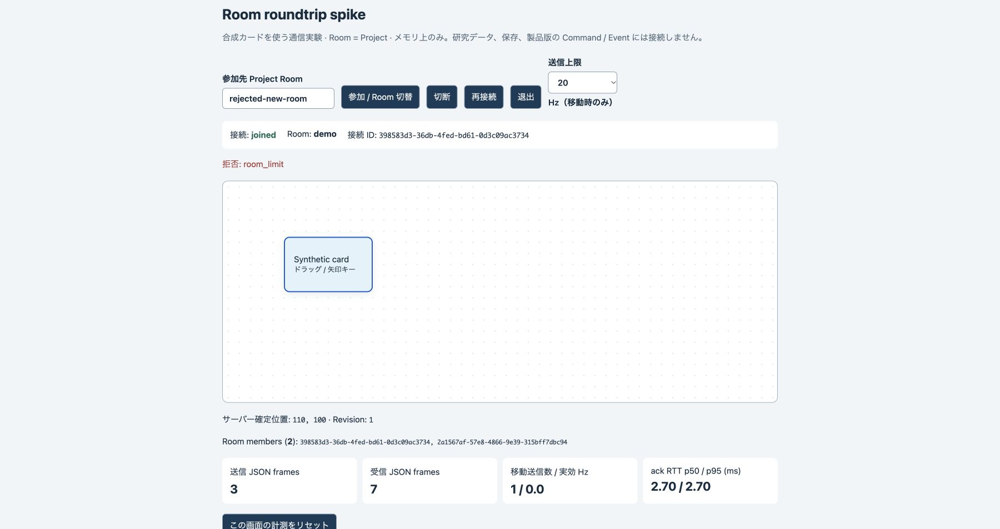

# #23 実ブラウザの Room 往復証拠

2026-10-27、`spike/23-room-roundtrip` の独立した source CLI を loopback `http://127.0.0.1:50039/?project=demo` で起動し、Chrome の二つのタブを使用した。合成カードのみ。これらの PNG は実画面のキャプチャであり、研究データではない。

- [client-a.png](./client-a.png): A 側の実ドラッグ後、サーバー確定位置 **320,190 / revision 3 / members 2**。
- [client-b.png](./client-b.png): 同じ時点の B 側にも **320,190 / revision 3 / members 2** が反映。
- [updated-a.png](./updated-a.png): B を明示切断し、A の右・下矢印操作で **330,200 / revision 5** へ更新。B 切断中は A の members が 1 になり、B のカード操作は無効になることも確認。
- [reconnected-b.png](./reconnected-b.png): B を再接続し、接続 ID が更新され、最新 snapshot の **330,200 / revision 5 / members 2** へ復帰。

初期状態は両方 **100,100 / revision 0**。A で実際の pointer drag（画面位置 [580,490] → [800,580]）を行い、その後 B の切断 → A の更新 → B の再接続を行った。A の console は Zotero 拡張に由来するもののみ、B の console は空で、アプリ由来の console error はなかった。

スクリーンショットから別端末への片道遅延を算出しない。RTT の時計・frame 数の定義、再現コマンド、E3/E4 への引継ぎは [ADR-013](../../decisions/013-room-roundtrip-spike.md) を参照。

## レビュー修正後の追加確認

修正後の compiled spike を別ポートで起動し、実 WS クライアントで15個の合成 Room を用意した後、Chrome 2タブを demo に参加させた。17個目の新 Room への切替は `room_limit` として拒否されたが、元の demo の members=2 と操作可能なカードは維持された。A の矢印キー操作は両タブで 110,100 / revision 1 として同期した。参加先入力と現在の Room は区別される。

