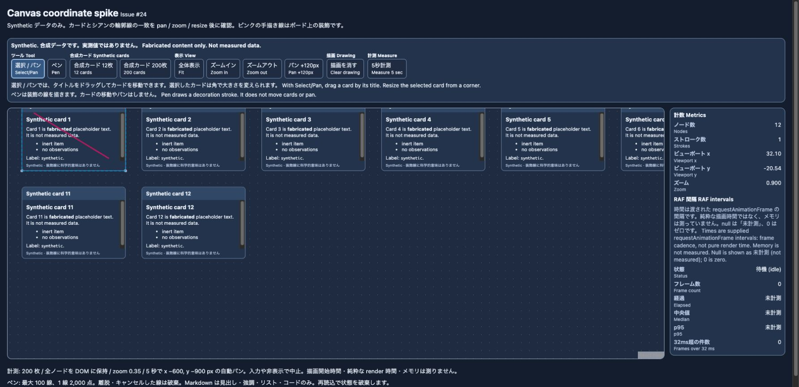
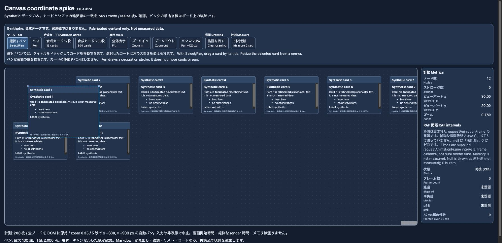
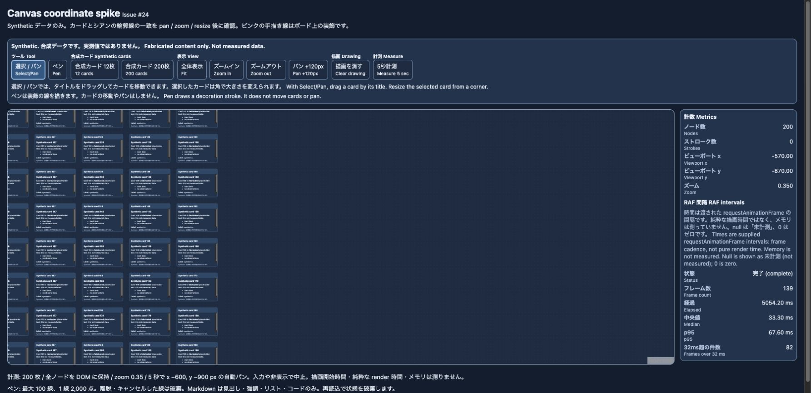

# Issue #24: Canvas overlay の実ブラウザ記録

2026-10-27、`spike/24-canvas-overlay`、main `4b026c916340b80640324f25944938fa60d539ed` に追従した独立 preview build を Chrome で操作した記録。[ADR-014](../../decisions/014-canvas-overlay-spike.md) の座標同期判断と性能上の制限を補う。

## 条件

- URL: `http://127.0.0.1:4174/canvas-spike.html`
- 実行: `vp run --filter ./apps/web spike:canvas:build` → `vp run --filter ./apps/web spike:canvas:preview`
- 操作画面: desktop、viewport 1800×873 CSS px、dark。
- Browser: Chrome。正確な version と OS は未記録。キャッシュ状態、画面 refresh rate、電源状態も未記録。
- 合成データのみ。200枚は10列の固定グリッド、各260×180、間隔300×220、軽量 Markdown。`onlyRenderVisibleElements=false`。DOM の `.react-flow__node` は200個を確認。
- 保存画像を実際に開いて表示内容を確認した。light / mobile はこの証拠セットでは未確認。科学データ、保存、Room、API、AI の動作の証拠ではない。

## レイヤー修正後の操作

最初のブラウザ確認では、ストローク数が増えても選択カードの上の線が見えなかった。選択カードの既定 z-index 1000 に対して SVG の子要素だけを前面化していたため、portal 自体を1001へ変更した。portal / SVG は `pointer-events: none` を保ち、ペン入力面は renderer より前面に置く。この修正後の build で以下を確認した。

- カードの上にピンクの手描き線が見え、シアン輪郭も見える。ペンからナビゲーションへ戻し、pan / zoom 後に線とカードの相対位置が一致することを目視確認。ストローク数は1。
- タイトル drag と corner resize が動作する。カード client bounds は left=100 / top=308.75 / width=255 / height=184.5、SVG 輪郭は left=100.00025177 / top=308.75024414 / width=255 / height=184.5 CSS px。今回の差は0.0003 CSS px未満。この値は他の位置や倍率を含む誤差上限の測定ではない。
- 1800×873でページの横はみ出しはない。取得上限12件の warning / error console 読み出しは空だった。未観測条件までエラー不在を保証しない。

手描き線はボード座標の装飾であり、後からカードを動かした際にカードへ追従する仕様ではない。

## 200枚・5秒の自動パン

計測ボタンで200枚を再生成し、viewport (30,30)、zoom 0.35へ戻す。commit 後に二つの RAF を待ち、5秒でx−600 / y−900 CSS pxの自動パンを行う。開始直後のロード時間を除き、RAF callback timestamp の差分を採取する。

| 観測項目 | 値 |
|---|---:|
| カード数 / DOMノード数 | 200 / 200 |
| 状態 | complete |
| RAF間隔サンプル数 | 139 |
| 実経過 | 5054.20 ms |
| RAF間隔p50 | 33.30 ms |
| RAF間隔p95 | 67.60 ms |
| 32ms超の間隔数 | 82 |
| 完了時viewport | x=−570, y=−870, zoom=0.35 |

保存画像の旧ラベル「フレーム数」は実装上の RAF **間隔サンプル数**。レビュー後に画面ラベルも「RAF 間隔サンプル数 / Interval samples」へ修正した。React commit / GPU render の所要時間やメモリ使用量ではない。UIに表示された丸め値を記録した。生の全区間配列は保存していない。

p50の33.30 msは30 Hzの通常cadenceとも整合する。refresh rate、電源・省電力状態、計測前の待機時RAF基準値を記録していないため、この単一実行から通常の30 Hz cadenceと描画処理による遅延・引っかかりを区別できない。32 ms超の件数は固定閾値の計数であり、環境に対する欠落フレーム数ではない。200枚で60fpsや本番性能を達成した結果として扱わない。React Flow の座標同期の成立は確認できた一方、製品化には profiling、viewport 外の描画省略・virtualization、より複雑なカードを含む再計測が必要。基盤同士の優劣、他の環境での性能、原因が React Flow 単体にあることはこの記録から断定できない。

最終ラベルを含む dedicated build を再読み込みして確認した画面は [review-fixed-label.png](./review-fixed-label.png)。この画面は 12 枚・未計測であり、上の 200 枚計測を再測定したものではない。
